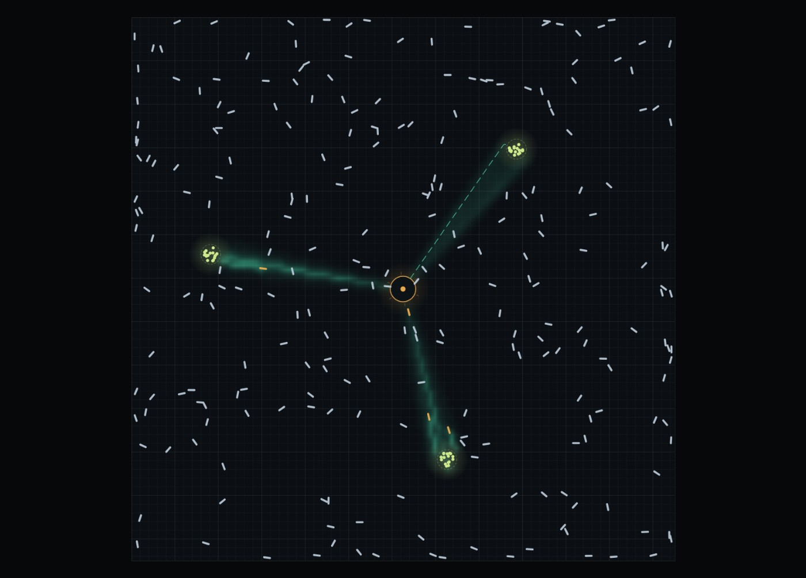

# Ant Colony Simulator 2.0

An interactive, browser-based ant colony **laboratory** that demonstrates **stigmergy** — how a colony of simple agents produces intelligent-looking collective behavior with no leader and no plan. Watch the full arc: **chaos → first ant finds food → pheromone trails appear → routes get reinforced → stable paths emerge**. Then change the conditions and compare what happens.

Built with TypeScript and the Canvas 2D API. Fully client-side, no dependencies at runtime.

Built with TypeScript and the Canvas 2D API. Fully client-side, no dependencies at runtime.



## How it works (short version)

1. Each ant wanders randomly while **SEARCHING**.
2. A searching ant that walks onto a food source picks it up and switches to **RETURNING**.
3. Returning ants head straight for the nest (path integration) and deposit **food pheromone** on the way.
4. Searching ants deposit **home pheromone**; both pheromones evaporate and diffuse over time.
5. Ants sample three sensors (left / ahead / right) and steer toward the strongest pheromone.
6. Short routes are walked more often per minute, so they accumulate *more* pheromone faster than long routes — positive feedback.
7. Because pheromone evaporates, stale and dead-end routes fade away. The colony converges on short, reliable routes.

The **"How it works?"** modal in the app explains the same 7 steps interactively.

## Features

- **Real simulation** — every ant has position, heading, speed, and a SEARCHING/RETURNING state. Pheromone lives on two grids (food + home) with evaporation and diffusion. Ants never follow pre-drawn paths.
- **6 scenarios** — Open Field, Obstacle Field, Narrow Passage, Multiple Sources, Maze, Random.
- **Two pheromone views** — composite (both trails, strength shown by brightness/saturation) or food-only, with clamped color ramps that keep weak and strong trails clearly distinct.
- **Camera** — mouse-wheel zoom, drag to pan, fit-to-world button. Ants are drawn as oriented triangles so they stay legible at any zoom.
- **Show calculation mode** (key `C`) — click any ant to inspect it: state, food held, heading, carried-food timer, sensor readings (left/ahead/right), steering decision, perception radius, local pheromone gradient, and a live 60-frame decision log.
- **Controls** — Start/Pause, Reset, **Step** (advance exactly one logical tick), speed 0.25×–50×, ant count 100–5000, food count, map size 100–1000, and advanced sliders for pheromone strength, evaporation, sensor radius, wander randomness, pheromone following, ant speed, and obstacle count.
- **Live stats** — ants, food delivered, food remaining, sim time, ticks, explored share, FPS, best discovered route, average route length.
- **World editor** — toolbar above the map: Inspect/pan, Food (click to place, click again to remove), Nest (click to move), Wall (drag to draw), Erase. Walls can never cover the nest; buried ants are rescued to the nest. Clear walls / Restore map (from the same seed) included. Shortcuts `1`–`5`, `Esc` back to Inspect.
- **Laboratory** — three behaviour presets (see table), map seed with Apply/Random (same seed + settings = same map), timed experiments with auto-pause (1/3/5/10 min), JSON export/import of settings + map.
- **Runs & comparison** — save snapshots of finished runs, compare any two: delivery and exploration curves, plus a metric table with per-metric winners. Snapshots persist in localStorage.
- **Keyboard** — `Space` start/pause, `→` step, `R` reset, `F` fit view, `C` calculation mode.
- **Robustness** — all inputs are sanitized (NaN/Infinity/out-of-range clamped), ants are kept inside the world, imported files are validated with warnings instead of crashes, and layout generation is validated for every map size, obstacle count, and food count combination.

## Behaviour presets

Every preset rewrites the same six model parameters live (no rebuild needed):

| Preset | Strength | Evaporation | Detection | Following | Randomness | Speed |
|---|---|---|---|---|---|---|
| Balanced search | 0.06 | 0.0025 | 6 | 0.85 | 0.45 | 0.30 |
| Intense exploration | 0.03 | 0.006 | 8 | 0.45 | 1.00 | 0.34 |
| Fast reinforcement | 0.12 | 0.0012 | 6 | 0.95 | 0.25 | 0.30 |

## What each metric means

- **Delivered** — pickup counter: +1 each time a carrying ant reaches the nest.
- **First find** — sim-time of the first pickup (`—` while nothing is found).
- **Best / avg route** — shortest carry distance ever walked (world units); average over the last 24 deliveries.
- **Explored** — share of walkable grid cells entered by ≥ 1 ant (nest cell only ≈ 0%).
- **Rate** — delivered per simulated minute.
- Charts sample every 0.5 sim-second (max 600 points per snapshot).

## Config files

Export downloads `{app, version: 2, name, settings, layout | null, seed}` as JSON. Import re-validates everything: unknown versions import best-effort with warnings, out-of-range values are clamped, wall/food lists are trimmed (64/12), and invalid JSON is rejected with a message — the running simulation is never touched by a bad file.

## Quick start

```bash
npm install        # installs TypeScript (dev only)
npm run build      # compiles src/ -> js/ with tsc
npm run serve      # static server on http://localhost:8080
```

Then open <http://localhost:8080/>.

```bash
npm test           # build + node --test unit tests
npm run check      # type-check only (no emit)
```

> GitHub Pages serves `.js` files as `text/plain` unless a `.nojekyll` file is present — a `.nojekyll` file is already included in the repo root, keep it.

## Project structure

```
index.html          markup: canvas, control panel, stats bar, modals
css/style.css       dark "digital lab" theme (+ editor, lab, compare, mobile)
js/                 compiled ES modules (built output, committed for Pages)
src/
  main.ts           app bootstrap, camera input, frame loop, UI wiring
  ui/               panels, inspector, stats, modal, toast, editor, lab, compare, charts
  render/           canvas renderer (world, ants, pheromone, overlays)
  sim/              simulation: ants, pheromone field, metrics, paths
  entities/         food sources, walls
  world/            obstacle layouts + validated layout factory (+ editor API)
  config/           settings (ranges + sanitizing), scenarios, tuning
  lab/              behaviour presets, experiment history/compare, JSON config IO
  util/             PRNG, math helpers, color ramp
tests/              node --test unit tests (core + editor + lab + params + IO)
scripts/server.js   dependency-free static file server
```

## Technologies

- **TypeScript 5** (strict mode) compiled to native ES modules — no bundler, no framework.
- **Canvas 2D** rendering with offscreen pre-rendered sprites (nest, food, ants) and an ImageData pheromone layer.
- **node --test** for unit tests; a hand-rolled static server for development.

## Deployment (GitHub Pages)

1. Push the repository to GitHub.
2. Settings → Pages → Source: **Deploy from a branch** → `main` / `/ (root)`.
3. The site is served at `https://<user>.github.io/<repo>/` — all paths are relative, so no configuration is needed.

## License

MIT
